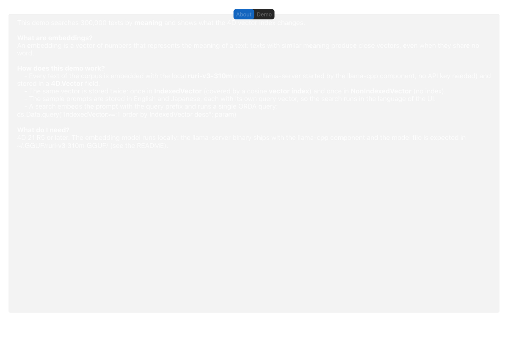
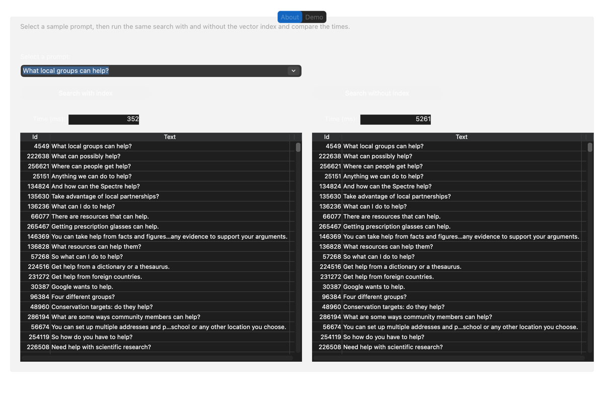
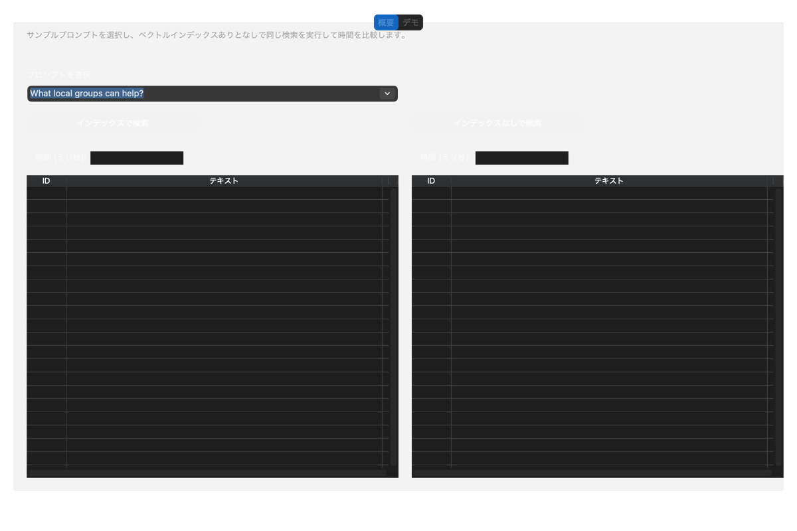

# HDI_Vector_Indexation

Search 300,000 texts by **meaning** and see what a 4D **vector index** changes:
the same cosine-similarity query is run twice over the same vectors — once over
an indexed `4D.Vector` field and once over a non-indexed one — and both times
are shown side by side. Originally published by 4D as a **HDI** (*How Do I*)
example; restored so it runs on current 4D releases with a fully local
embedding model (no API key, no AI provider account).

## What it demonstrates

- Storing embeddings in `4D.Vector` entity attributes (`Data.IndexedVector`,
  `Data.NonIndexedVector` — the same vector twice, one field indexed, one not).
- Creating a cosine **vector index** with `CREATE INDEX` and querying it with a
  single ORDA query:
  `ds.Data.query("IndexedVector>=:1 order by IndexedVector desc"; param)`.
- Running the same query against the non-indexed field and comparing the
  timings in the demo window.
- A fully local embedding pipeline: the **llama-cpp component** starts a
  bundled `llama-server` and **4D AI Kit** calls it through its
  OpenAI-compatible client (`cs.AIKit.OpenAI.new(...).embeddings.create(...)`).
- Bilingual prompts (English and Japanese): each sample prompt is stored with
  its own query vector, so the search runs in the language of the UI.
- A complete, localised demo UI (English and Japanese): XLIFF resources and
  per-language HTML help pages.

## Key commands

| Command | Used for |
|---|---|
| `CREATE INDEX([Data]; $fields; Vector cosine index; "IndexedVector_cosine")` | builds the vector index on `Data.IndexedVector` |
| `ds.Data.query("IndexedVector>=:1 order by IndexedVector desc"; {vector; metric; threshold})` | similarity search over the vector index |
| `ds.Data.query("NonIndexedVector>=:1 order by NonIndexedVector desc"; ...)` | the same search without the index (full scan) |
| `cs.llama.llama.new(...)` | starts the bundled llama-server with the ruri-v3-310m model |
| `cs.AIKit.OpenAI.new({baseURL; apiKey}).embeddings.create(...)` | embeds texts and queries through the local server |
| `Localized string()` | resolves `:xliff:` ids at runtime (menus, labels, tooltips) |
| `Localized document path()` | locates `Resources/<lang>.lproj/` documents (help pages) |
| `SET DATABASE LOCALIZATION()` | follows the OS language (English or Japanese) at startup |
| `CALL WORKER(1; ...)` | opens the demo window in the application process without blocking |

## Requirements

- 4D 21 R5 or a later **feature release**.
- The components `4d/4D-AIKit` and `miyako/llama-cpp` (with their own
  dependencies), resolved through `Project/Sources/dependencies.json` on first
  open (network access required for the download; `tool4d` headless runs do
  not download dependencies — stage them in `Components/` yourself, see
  `.agents/skills/4dproject/references/dependencies.md`).
- The embedding model **ruri-v3-310m** (q8_0 GGUF, ≈ 337 MB) in
  `~/.GGUF/ruri-v3-310m-GGUF/ruri-v3-310m-q8_0.gguf`:

  ```sh
  mkdir -p ~/.GGUF/ruri-v3-310m-GGUF
  curl -L -o ~/.GGUF/ruri-v3-310m-GGUF/ruri-v3-310m-q8_0.gguf \
    "https://huggingface.co/rclon/ruri-v3-310m-GGUF/resolve/main/ruri-v3-310m-q8_0.gguf"
  ```

  The model runs locally on the llama-server binary that ships with the
  llama-cpp component; nothing is sent to an external service. It is only
  needed to **rebuild** the data — the demo itself searches prebuilt vectors
  (the sample prompts ship with their own embeddings in the `Prompts` table),
  so attendees can run it without downloading the model.

## Getting started

- Clone or download this repository and open the project via
  **File > Open Project** in 4D.
- The demo window opens on launch. The **About** tab explains the demo; the
  **Demo** tab compares the two searches.
- Pick a sample prompt, click **Search with index**, then **Search without
  index**, and compare the `Time (ms)` fields. On 300,000 texts the indexed
  query answers in a few hundred milliseconds while the full scan takes about
  ten seconds.
- The prompts are bilingual: a Japanese prompt finds English answers, because
  the embedding model is multilingual.
- Navigate to the "Mode/Return to design mode" menu to view the code.

## How the demo was measured

With the shipped data (300,000 texts, 768-dimension ruri-v3-310m vectors,
cosine similarity, threshold 0.85), on an Apple Silicon Mac:

| Query | Time |
|---|---|
| Vector index (`IndexedVector >= :1`) | ≈ 320 ms |
| Full scan (`NonIndexedVector >= :1`) | ≈ 11,200 ms |

The threshold is model-specific: with ruri-v3, unrelated texts still score
around 0.80 cosine similarity, so a lower threshold floods the result with
noise — and slows the indexed query down as well (below ≈ 0.75 the index
degrades toward full-scan times). Calibrate on your own corpus before reusing
the number.

## Rebuilding the data

`Data/` ships prebuilt (see *Downloading Large Files* below). To rebuild it
from the corpus (`Resources/train.txt`, 300,000 English lines):

```sh
tool4d \
  --project Project/HDI_Vector_Indexation.4DProject \
  --data Data/data.4DD --create-data \
  --startup-method=BuildData --skip-onstartup
```

The build drops all records, embeds the corpus in batches of 128 with the
document prefix (`検索文書: `), embeds the bilingual prompts with the query
prefix (`検索クエリ: `), creates the vector index and writes `build.report`.

## Downloading Large Files

The repository ships without `Data/` (the prebuilt data file is ≈ 1.9 GB, too
large for a Git clone). Download **Data.zip** from the
[latest release](https://github.com/miyako/HDI_Vector_Indexation/releases/latest)
and unzip it into the project folder, so the project contains
`Data/data.4DD`:

```sh
unzip HDI_Vector_Indexation_Data.zip -d HDI_Vector_Indexation
```

The archive contains the 300,000-text corpus with both vector fields, the
vector index and the bilingual prompts — everything the demo needs; no model
download is required to run it.

## Screenshots




